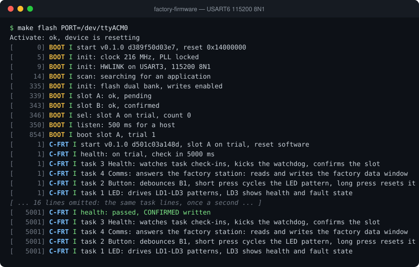

# factory-firmware

[](LICENSE)
[](docs/ARCHITECTURE.md)
[](CHANGELOG.md)

The first application a fresh NUCLEO-F767ZI runs after the factory station
has flashed the bootloader. It is a FreeRTOS application in C, linked for
slot A, that answers the factory station over the ST-LINK virtual COM port.
It reports its name and version and writes the per-unit system info,
calibration data and diagnostic map into the factory data window of the
identity sector.

It is derived from
[app-c-freertos](https://github.com/soccentric-stm32/app-c-freertos) and
keeps its health supervision, watchdog and BOOT handover.

## Debug terminal

The debug log from a reset on a NUCLEO-F767ZI (USART6, 115200 8N1), recorded from the board. [Watch it replay line by line](https://soccentric-stm32.github.io/#factory-firmware) on the project page.



<details>
<summary>Plain text</summary>

```console
$ make flash PORT=/dev/ttyACM0
Activate: ok, device is resetting
[      0] BOOT I start v0.1.0 d389f50d03e7, reset 0x14000000
[      5] BOOT I init: clock 216 MHz, PLL locked
[      9] BOOT I init: HWLINK on USART3, 115200 8N1
[     14] BOOT I scan: searching for an application
[    335] BOOT I init: flash dual bank, writes enabled
[    339] BOOT I slot A: ok, pending
[    343] BOOT I slot B: ok, confirmed
[    346] BOOT I sel: slot A on trial, count 0
[    350] BOOT I listen: 500 ms for a host
[    854] BOOT I boot slot A, trial 1
[      1] C-FRT I start v0.1.0 d501c03a148d, slot A on trial, reset software
[      1] C-FRT I health: on trial, check in 5000 ms
[      1] C-FRT I task 3 Health: watches task check-ins, kicks the watchdog, confirms the slot
[      1] C-FRT I task 4 Comms: answers the factory station: reads and writes the factory data window
[      1] C-FRT I task 2 Button: debounces B1, short press cycles the LED pattern, long press resets it
[      1] C-FRT I task 1 LED: drives LD1-LD3 patterns, LD3 shows health and fault state
[ ... 16 lines omitted: the same task lines, once a second ... ]
[   5001] C-FRT I health: passed, CONFIRMED written
[   5001] C-FRT I task 3 Health: watches task check-ins, kicks the watchdog, confirms the slot
[   5001] C-FRT I task 4 Comms: answers the factory station: reads and writes the factory data window
[   5001] C-FRT I task 2 Button: debounces B1, short press cycles the LED pattern, long press resets it
[   5001] C-FRT I task 1 LED: drives LD1-LD3 patterns, LD3 shows health and fault state
```

</details>

## Highlights

- Runs from the BOOT slot at `0x0800C000` under the A/B bootloader
- Factory commands over UART with HWLINK framing (COBS, CRC-32) and
  protocol byte `0x46`
- `INFO` returns firmware name, version, build date and chip UID
- `READ` returns any bytes of the factory data window and the identity record
- `WRITE_BEGIN`, `WRITE_DATA` and `WRITE_END` stage, validate and program one
  `.sys`, `.cal` or `.diag` file
- Checks the file header, header CRC, payload CRC and chip UID binding before
  touching flash
- Programs the 4 KB block by read-modify-write of the identity sector and
  reads it back
- `DIAG_INIT` writes a clean fault and diagnostic map
- `SELFTEST` reports device ID, flash size, clock, RAM, CRC, flash read and
  option-byte checks without writing flash
- Refuses any write outside the three factory data blocks, so the PRV1
  identity record is never overwritten
- Existing HWLINK commands (`Hello`, `Reset`, `EnterBootloader`) keep working
  on protocol byte `1`
- Host tests run the real command handler against a simulated flash

## Project layout

```text
factory-firmware/
├── board/            NUCLEO-F767ZI pin map and FreeRTOS/HAL configuration
├── ci/               packaging, version and release helpers
├── docs/             factory contract and architecture
├── docker/           stm32-dev container image
├── ld/               application linker script
├── protocol/         HWLINK FlatBuffers schema and generated-header notes
├── scripts/          build, flash, serial, image and footprint tools
├── src/
│   ├── app/          entry point, fault record, debug log, task reporting
│   ├── bsp/          clock, HAL tick, cache/MPU, USART3 DMA driver
│   ├── platform/     BOOT contract, handover, reset cause, IWDG, confirmation
│   ├── services/     CRC-32, identity reader, factory flash store, flatcc arena
│   ├── protocol/     HWLINK framing and factory command handler
│   ├── tasks/        Health, Comms, Button and LED FreeRTOS tasks
│   └── generated/    flatcc headers from protocol/hwlink.fbs
├── tests/host/       command-handler tests against a simulated flash
└── third_party/      vendored flatcc runtime
```

The source layers and the runtime data flow are described in
[docs/ARCHITECTURE.md](docs/ARCHITECTURE.md).

## Build and run

The cross build, flashing and debugging run inside the `stm32-dev` Docker
image. The host tests need only a C compiler.

```bash
scripts/docker-dev.sh build   # build the stm32-dev container image once
scripts/build.sh              # build inside the container
make test                     # host tests of the command handler
make lint                     # clang-tidy static analysis
make help                     # all targets
```

The build produces:

| File                  | Purpose                                            |
| --------------------- | -------------------------------------------------- |
| `build/factory.elf`   | ELF with debug symbols, for GDB and the map file   |
| `build/factory.bin`   | Raw application binary                             |
| `build/factory.hex`   | Intel HEX application image                        |
| `build/factory.map`   | Linker map                                         |
| `build/factory.img`   | Signed-image payload for the bootloader            |

The station signs `build/factory.img` with your key and flashes it through
the bootloader. `make flash` does the same with the local development key.

The memory map, file formats and command set are in
[docs/FACTORY_SPEC.md](docs/FACTORY_SPEC.md). The container description is
in [docker/README.md](docker/README.md).

## Testing

The factory command handler is hardware-agnostic: flash, UID and self-test
access go through a function table. The host tests implement that table
against an in-memory identity sector, so the real handler is exercised
without a board.

```bash
make test
```

See [tests/README.md](tests/README.md) for the test layout and the shared
simulator library used by the factory station.

## Documentation

- [docs/FACTORY_SPEC.md](docs/FACTORY_SPEC.md) — wire protocol, file formats
  and flash layout shared with the factory station
- [docs/ARCHITECTURE.md](docs/ARCHITECTURE.md) — source layers, tasks and
  data flow
- [CONTRIBUTING.md](CONTRIBUTING.md) — workflow, C style and review checklist
- [CHANGELOG.md](CHANGELOG.md) — release history
- [SECURITY.md](SECURITY.md) — how to report a vulnerability
- [protocol/README.md](protocol/README.md) — HWLINK schema and code generation

## Related projects

- [bootloader](https://github.com/soccentric-stm32/bootloader) — A/B
  bootloader with UART update, CRC32 checks, trial boot and rollback
- [app-c-freertos](https://github.com/soccentric-stm32/app-c-freertos) — demo
  application in C on FreeRTOS
- [factory-station](https://github.com/soccentric-stm32/factory-station) —
  HWVAL Factory: end-of-line test and provisioning station
- [soccentric-stm32.github.io](https://github.com/soccentric-stm32/soccentric-stm32.github.io)
  — project website

## License

Released under the [MIT License](LICENSE) © 2026 Sandesh Ghimire. You are
free to use, modify and ship it in your own products.

Contributions are welcome. Read [CONTRIBUTING.md](CONTRIBUTING.md), fork the
repository, make your change on a branch and open a pull request. Bug
reports, ideas and improvements are all appreciated.
